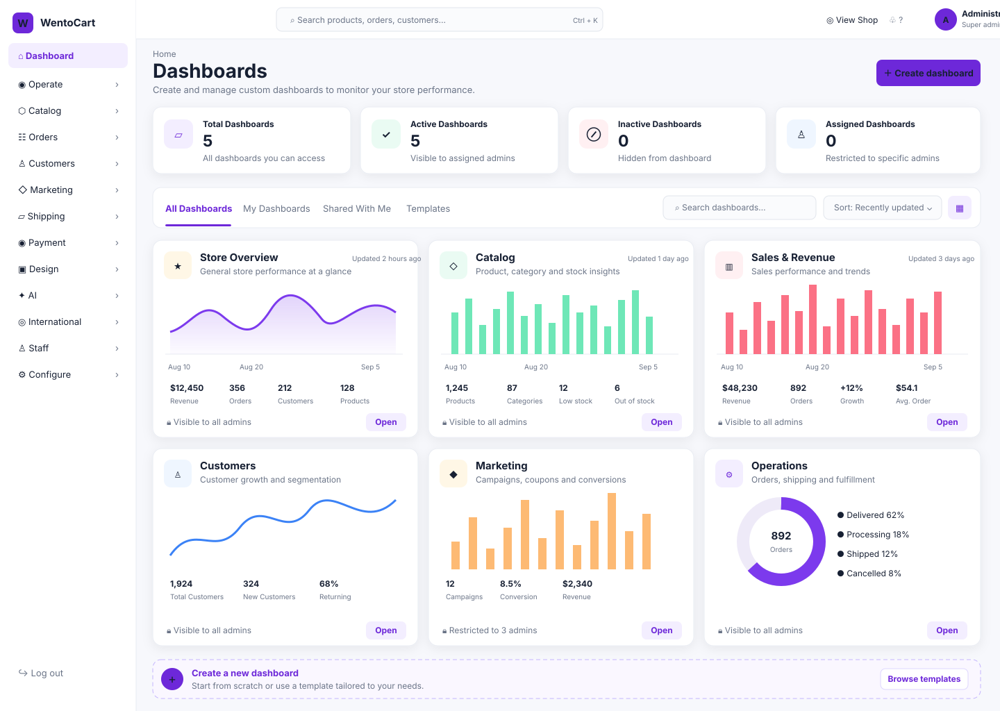
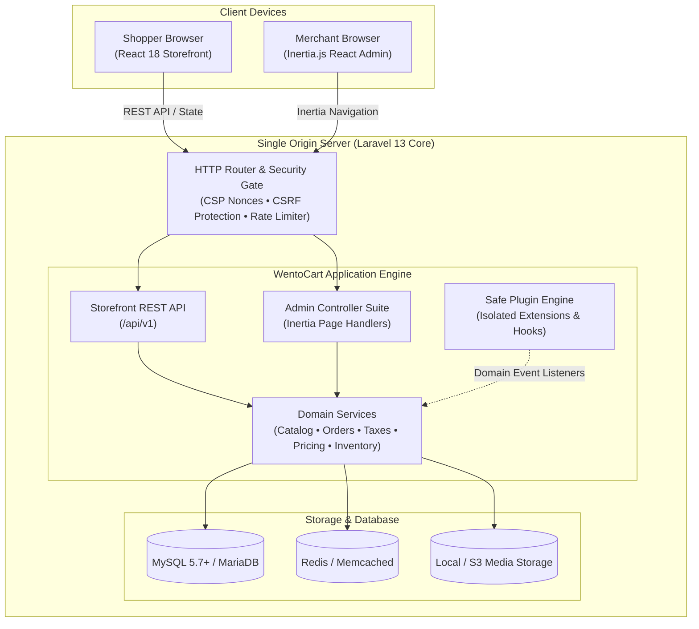

<p align="center">
  <a href="https://wentocart.com" target="_blank" rel="noopener noreferrer">
    <picture>
      <source media="(prefers-color-scheme: dark)" srcset="docs/images/logo-dark.png">
      <source media="(prefers-color-scheme: light)" srcset="docs/images/logo.png">
      
    </picture>
  </a>
</p>

<h2 align="center">Open-Source Self-Hosted Commerce Platform</h2>

<p align="center">
  <b>Engineered with Laravel 13 & React for Enterprise-Grade Speed, Complete Data Ownership, and Zero Recurring Platform Fees.</b>
</p>

<p align="center">
  <a href="https://github.com/wentocart/wentocart/releases"></a>
  <a href="https://github.com/wentocart/wentocart/stargazers"></a>
  <a href="https://github.com/wentocart/wentocart/network/members"></a>
  <a href="LICENSE"></a>
  <a href="https://github.com/wentocart/wentocart/actions"></a>
  <a href="docs/INSTALL.md"></a>
  <a href="https://laravel.com"></a>
  <a href="https://react.dev"></a>
  <a href="https://demo.wentocart.com"></a>
</p>

<p align="center">
  <a href="https://wentocart.com"><b>Website</b></a> •
  <a href="https://demo.wentocart.com"><b>Live Demo</b></a> •
  <a href="https://demo.wentocart.com:8443/admin/login"><b>Admin Preview</b></a> •
  <a href="https://wentocart.com/documentation"><b>Documentation</b></a> •
  <a href="https://marketplace.wentocart.com"><b>Marketplace</b></a> •
  <a href="https://wentocart.com/download/"><b>Download Zip</b></a> •
  <a href="#-quick-start"><b>Quick Install</b></a> •
  <a href="#-community--support"><b>Community</b></a>
</p>

<p align="center">
  
  
  
  
  
  
  
  
  
  
  
  
  <br>
  <span style="font-size:12px;color:#888;"><b>Out-of-the-Box Localization & Multi-Currency Ready</b></span>
</p>

---

## 📖 Introduction

**WentoCart** is a modern, open-source commerce platform built on **Laravel 13** and **React**. It gives businesses, agencies, and developers an independent foundation to launch high-performance eCommerce stores, B2B wholesale portals, and multi-vendor marketplaces without recurring platform commissions or cloud vendor lock-in.

Whether you run a high-volume boutique store, a multi-warehouse catalog, or a complex subscription service, WentoCart bridges the gap between modern frontend speed and rock-solid backend reliability.

<p align="center">
  
  <br>
  <sub><b>Figure 1:</b> WentoCart Back-Office — Unified Single-Page Administration Built with Laravel 13, Inertia.js, and React.</sub>
</p>

---

## 🚀 Commercial Feature Pillars

### 🛍️ 1. Ultra-Fast Storefront (React 18 SPA)
* **Instant Client-Side Transitions:** Zero white flashes between pages; product browsing, category filtering, and cart updates occur instantaneously.
* **Server-Side SEO Meta Pre-Rendering:** Laravel renders HTML titles, descriptions, OpenGraph tags, canonical links, and Schema.org JSON-LD before React hydrates.
* **Frictionless Single-Page Checkout:** Streamlined step-by-step or accordion checkout flow supporting guest purchases, account creation, and multiple shipping rates.
* **Live Attribute Filtering:** Faceted search with real-time price sliders, category trees, brand filters, and stock availability toggles.

### 🎛️ 2. Inertia.js React Admin Back-Office
* **Single-Page Back-Office:** Lightning-fast administration experience without browser reloads, built with Inertia.js and React components.
* **Complete Order Lifecycle:** Visual fulfillment stages, payment transaction tracking, package tracking numbers, and automated PDF invoice generation.
* **Customer Desk & RMA Returns:** Dedicated customer support workflows, return merchandise authorizations (RMA), refund management, and inquiry tickets.
* **Granular Role-Based Access:** Multi-staff management with discrete read/write permissions per section and comprehensive audit logs.

### 🏢 3. B2B & Wholesale Commerce Ready
* **Customer Group Tier Pricing:** Define wholesale discounts, custom pricing matrices, and volume quantity breaks per customer group.
* **Tax Exemption Workflows:** Automated EU VAT validation, B2B tax-exempt registration, and reverse-charge handling.
* **Quote Requests & Bulk Ordering:** Flexible purchasing controls for enterprise accounts requiring approval or custom billing agreements.

### 🏪 4. Multi-Vendor Marketplace Capabilities
* **Vendor Self-Onboarding:** Streamlined seller registration and account verification workflows.
* **Dedicated Vendor Storefront Portals:** Approved sellers manage their catalog, orders, and earnings through an isolated storefront dashboard without accessing `/admin`.
* **Flexible Commission Structures:** Configure global, vendor-specific, or category-based marketplace commission fees.

### 📦 5. Advanced Catalog & 6 Product Types
WentoCart natively handles diverse product models out of the box:
* **Simple Products:** Standard physical inventory with barcode, SKU, dimensions, and warehouse tracking.
* **Configurable Products:** Multi-dimensional variant matrices (Size, Color, Material) with independent pricing, images, and stock.
* **Virtual & Downloadable:** Secure file downloads with expiration dates and download count limits.
* **Product Bundles & Kits:** Combine multiple items into discounted bundles with dynamic component pricing.
* **Recurring Subscriptions:** Daily, weekly, monthly, or yearly recurring billing cycles for memberships and repeat products.
* **Bookings & Rentals:** Hourly and daily rental slots with reservation calendars, care terms, and late return penalty policies.

### 🤖 6. AI-Powered & LLM Ready
* **Native `llms.txt` Endpoint:** Standardized discovery schemas allowing AI crawlers and personal shopping agents to parse store inventory.
* **Storefront Assistant Ready:** Built-in schema catalog endpoints ready for conversational AI shopping assistants.
* **Automated Catalog Workflows:** Extensible domain hooks for AI-assisted product descriptions, SEO meta tag generation, and image tagging.

### 🧩 7. Safe Plugin & Theme Ecosystem
* **Zero Core Modifications:** Build custom functionality using modular apps located in `extensions/` that hook into core domain events.
* **Guaranteed Safe Upgrades:** Update core WentoCart versions effortlessly without breaking or overwriting custom modules.
* **CLI App Tooling:** Generate compliant extension scaffolding in seconds using `php artisan wento:make-app`.
* **Vetted Marketplace:** Discover and install tested community plugins and themes from [marketplace.wentocart.com](https://marketplace.wentocart.com).

### 🌍 8. Global Commerce, Localization & Taxes
* **Multi-Currency Engine:** Real-time foreign exchange rate synchronization with custom symbols, decimals, and rounding rules.
* **Multi-Language Architecture:** Full internationalization support with JSON translation tables across European, Asian, and RTL languages.
* **Geo-Zone Tax Engine:** Flexible country, state, and zip-code tax calculations with full support for destination-based and origin-based taxes.
* **Carrier & Shipping Engine:** Flat-rate, weight-bracketed, order-total-bracketed, and carrier API shipping connectors.

---

## 🏗️ Architecture Overview

WentoCart delivers the speed of a decoupled headless application while maintaining the simplicity and security of a single domain:



---

## 💻 Tech Stack & System Requirements

### Technology Stack
* **Backend:** PHP 8.3 or PHP 8.4, Laravel 13 Core
* **Storefront:** React 18, Vite 8, Tailwind CSS
* **Back-Office Admin:** Inertia.js, React 18, Tailwind CSS
* **Session & Security:** Laravel Sanctum (Stateful HTTP-only Cookies & CSRF Protection)
* **Database:** MySQL 5.7+, MariaDB 10.4+ *(SQLite supported for testing/CLI)*
* **License:** [Open Software License 3.0 (OSL-3.0)](LICENSE)

### Server Requirements
Ensure the following PHP extensions are enabled on your server:
```text
pdo_mysql, mbstring, openssl, tokenizer, xml, ctype, json, fileinfo, curl, gd, zip, intl, bcmath
```

---

## ⚡ Quick Start

Choose the path that fits your setup:

### Path A: For Merchants (1-Click Web Setup)

1. Download the official release package: **[wentocart.zip](https://wentocart.com/download/)**
2. Extract the archive into your web server's document root (`htdocs` or `/var/www/html`).
3. Start the installer:
   * **Windows / Local:** Double-click `Install.vbs`
   * **Linux / macOS:** Run `chmod +x install.sh && ./install.sh`
   * **Shared Hosting / cPanel:** Open your website domain in any browser (`https://your-store.com/`).
4. Follow the 4-step web wizard:
   * **Step 1:** System preflight checks (PHP version & extensions)
   * **Step 2:** Store configuration (Store name & currency)
   * **Step 3:** Database connection test
   * **Step 4:** Administrator account creation

---

### Path B: For Developers (Command-Line from Source)

**Prerequisites:** PHP 8.3+, Composer 2.x, Node.js 20.19+ or 22.12+, and MySQL 5.7+ (or SQLite).

```bash
# 1. Clone the repository (or download & extract ZIP, then cd wentocart-main)
git clone https://github.com/wentocart/wentocart.git
cd wentocart

# 2. Install backend dependencies
composer install

# 3. Build frontend assets (Storefront & Inertia Admin)
npm install
npm run build

# 4. Launch the installer
# (Automatically configures .env, APP_KEY, database, admin user, and storage symlink)
php artisan wento:install

# 5. Start the local development server
php artisan serve
```

#### 🌐 Accessing Your Local Store
Once `php artisan serve` is running:
* **Storefront:** [http://127.0.0.1:8000](http://127.0.0.1:8000)
* **Admin Back-Office:** [http://127.0.0.1:8000/admin](http://127.0.0.1:8000/admin) *(Sign in with the administrator credentials you created in Step 4)*
* **Active Frontend Development:** Run `npm run dev` in a separate terminal for Vite hot module reloading (HMR).

> **💡 Zero-Config SQLite Quickstart (Zero MySQL setup needed):**
> ```bash
> php artisan wento:install --no-interaction --demo --db-connection=sqlite
> ```

> **🤖 Automated Headless Install (CI / Automated Scripts):**
> ```bash
> php artisan wento:install --no-interaction --demo \
>   --store-name="My WentoCart Shop" \
>   --url=http://127.0.0.1:8000 \
>   --db-connection=mysql \
>   --db-database=wentocart \
>   --db-username=root \
>   --db-password= \
>   --admin-email=admin@example.com \
>   --admin-password='AdminSecretPassword123'
> ```

---

## 🌐 Live Interactive Demos

Explore WentoCart live in your browser:

| Surface | URL | Access / Credentials |
| :--- | :--- | :--- |
| **Storefront** | [demo.wentocart.com](https://demo.wentocart.com) | Public customer storefront |
| **Admin Back-Office** | [demo.wentocart.com:8443/admin/login](https://demo.wentocart.com:8443/admin/login) | Username: `demo@demo.com`<br>Password: `demodemo` |
| **Extension Marketplace** | [marketplace.wentocart.com](https://marketplace.wentocart.com) | Explore vetted modules & themes |

---

## 🛠️ Developer CLI Tooling Suite

WentoCart ships with dedicated Artisan commands to streamline development, testing, and operations:

```bash
# Verify system prerequisites and environment health
php artisan wento:doctor

# Scaffold a brand-new safe modular extension
php artisan wento:make-app vendor/my-plugin

# Compile an extension into a distributable marketplace zip
php artisan wento:app-pack vendor/my-plugin

# Synchronize live foreign exchange rates from currency feeds
php artisan wento:currency-sync

# Rebuild search engine XML sitemaps
php artisan wento:sitemap-build

# Clean and optimize cached platform configuration
php artisan optimize:clear
```

---

## 📚 Documentation & Developer Guides

| Guide | Description |
| :--- | :--- |
| 📖 [Installation Guide](docs/INSTALL.md) | In-depth setup for Ubuntu, macOS, Windows, Docker, and Nginx. |
| 🎨 [Theme Customization](docs/THEMES.md) | Guide to styling the React storefront and creating child theme overrides. |
| 🧩 [Extension Architecture](docs/EXTENSIONS.md) | Building modular apps with isolated controllers, models, and routes. |
| 📋 [Extension Standards](docs/extensions/README.md) | Coding guidelines and security verification for marketplace submissions. |
| 🔄 [Upgrade Guide](UPGRADE.md) | Step-by-step instructions for upgrading existing WentoCart installations. |
| 🔒 [Security Policy](SECURITY.md) | Vulnerability disclosure guidelines and enterprise security measures. |
| 📜 [Changelog](CHANGELOG.md) | Detailed version history and release notes. |

---

## 🤝 Contributing

We welcome contributions from developers worldwide! Whether you are fixing an issue, adding translations, improving documentation, or creating new features:

1. Review our [Contributing Guidelines](CONTRIBUTING.md) and [Code of Conduct](CODE_OF_CONDUCT.md).
2. Fork the repository and create your feature branch: `git checkout -b feature/amazing-feature`.
3. Verify that tests pass: `php artisan test`.
4. Commit your changes: `git commit -m 'feat: Add amazing feature'`.
5. Push to your branch and open a Pull Request.

---

## 📄 License & Intellectual Property

**WentoCart Core** is open-source software licensed under the **Open Software License version 3.0 (OSL-3.0)**.  
See [LICENSE](LICENSE), [NOTICE](NOTICE), and [docs/LICENSING.md](docs/LICENSING.md) for full terms.

*Third-party marketplace extensions and themes may carry separate license terms. Installing extensions does not modify the core platform license.*

---

## ⭐ Support the Project

If you love what we are building with WentoCart, give us a **Star** on GitHub! It increases visibility, attracts contributors, and accelerates feature development.

<p align="center">
  <a href="https://github.com/wentocart/wentocart">
    
  </a>
</p>

---

<p align="center">
  <b>Built with ❤️ by the WentoCart Community</b><br>
  <a href="https://wentocart.com">wentocart.com</a> • <a href="https://demo.wentocart.com">Live Demo</a> • <a href="https://marketplace.wentocart.com">Marketplace</a> • <a href="https://github.com/wentocart/wentocart/issues">Report Issue</a>
</p>
